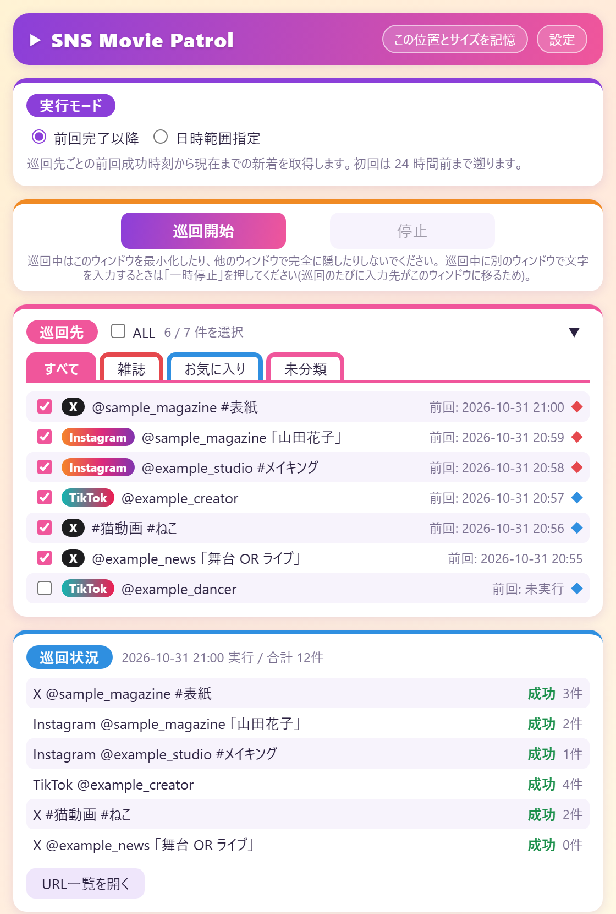
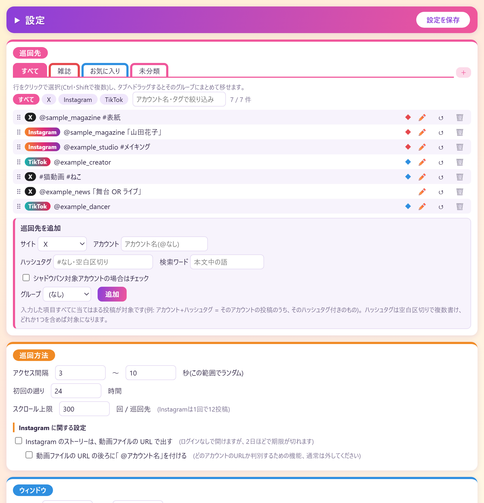
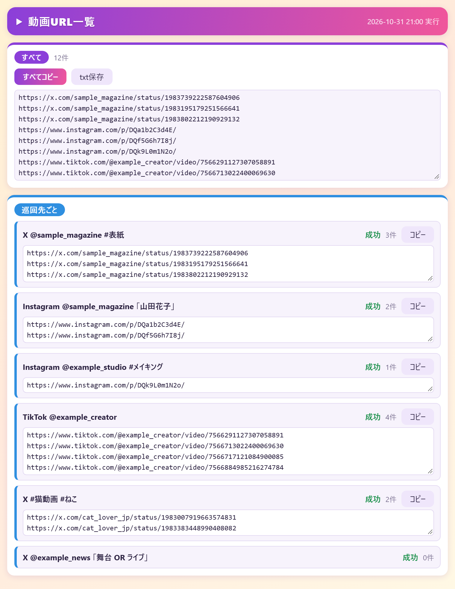

# SNS Movie Patrol

X・Instagram・TikTok の指定したアカウントやハッシュタグを巡回して、**動画付き投稿の URL を一覧にする**ブラウザ拡張です。

一覧は 1 行 1 URL のテキストで、コピーまたは txt 保存できます。[yt-dlp](https://github.com/yt-dlp/yt-dlp) や、その GUI ソフトにそのまま貼り付けられる形式です。この拡張自体は動画をダウンロードしません。

<p align="center"></p>

※ 画面写真のアカウント名・URL は、すべて説明用の架空のものです。

English: see [For English speakers](#for-english-speakers) at the end of this page.

## できること

- **3 サイトをまとめて巡回**: X、Instagram、TikTok の巡回先を登録しておき、ボタン 1 つで順番に巡回します。
- **新着だけを取得**: 巡回先ごとに前回の巡回時刻と取得済みの投稿を覚えていて、前回以降の新着だけを一覧にします。
- **日時の範囲を指定して取得**: 開始〜終了の日時(日本時間)を指定して、過去の投稿も取得できます。
- **アカウント + ハッシュタグ + 検索ワードで絞り込み**: 「この雑誌アカウントの投稿のうち、このメンバーの名前が入ったもの」のような指定ができます。
- **グループ分け**: 巡回先をグループに分けて、タブで切り替えられます。グループ単位で巡回できます。
- **巡回先ごと・全体の一覧**: 結果は巡回先ごとに分けて表示され、個別にも全体でもコピーできます。全体の一覧では同じ URL は 1 回だけ載ります。

## 導入方法 (Chrome)

Chrome ウェブストアには公開していないため、手動で読み込みます。

1. [Releases](../../releases) から `sns-movie-patrol-chrome-v*.zip` をダウンロードして展開します。`sns-movie-patrol` というフォルダができます。
2. Chrome で `chrome://extensions` を開き、右上の「デベロッパー モード」をオンにします。
3. 「パッケージ化されていない拡張機能を読み込む」を押して、展開した `sns-movie-patrol` フォルダを選びます。
4. 巡回したいサイト(X・Instagram・TikTok)に、そのブラウザでログインしておきます。

更新するときは、新しい zip を同じ場所に展開し直して、`chrome://extensions` の拡張の更新ボタン(↻)を押します。巡回先や履歴は引き継がれます。

普段使いとは別の Chrome プロファイルに入れることをおすすめします(理由は「注意事項」を参照)。

## 使い方

1. ツールバーの拡張ボタンを押すと、操作画面のウィンドウが開きます。
2. 「設定」を開き、巡回先を追加します。
   - **サイト**: X / Instagram / TikTok
   - **アカウント**: アカウント名(ID)を入れます。先頭の「@」は不要です。Instagram と TikTok では必須です。
   - **ハッシュタグ**: タグの文字だけを入れます。先頭の「#」は不要です。空白区切りで複数指定できます。
   - **検索ワード**: 本文に含まれる語を入れます。

   「@」や「#」を付けて入力した場合や、プロフィールの URL を貼った場合も、自動で取り除いて登録されます。

   

3. 操作画面に戻り、巡回したい巡回先にチェックを入れて「巡回開始」を押します。
4. 同じウィンドウの中でタブが 1 つずつ開いて閉じ、終わると結果のタブが開きます。
5. 「すべてコピー」または「txt保存」で一覧を取り出します。巡回先ごとの「コピー」で、その巡回先の分だけを取り出すこともできます。

   

巡回を途中でやめるときは、操作画面のタブに切り替えて「停止」を押します。巡回中だった巡回先は、そこまでに取れた分が結果に残ります(前回の巡回時刻は更新されません)。残りの巡回先は巡回しません。

巡回中は、ウィンドウを最小化したり他のウィンドウで完全に隠したりしないでください。ページの読み込みが止まります。

巡回中は、巡回先を開くたびに巡回ウィンドウのタブが切り替わるため、Chrome の別のウィンドウで文字を入力していると、入力先が巡回ウィンドウに移ることがあります。入力するときは「一時停止」を押してください。巡回中の巡回先が終わったところで止まり、「再開」を押すと次の巡回先から続けます。

### 実行モード

| モード | 動作 |
|---|---|
| 前回完了以降 | 巡回先ごとの前回成功時刻から現在までの新着を取得します。初回は 24 時間前まで遡ります(設定で変更可)。 |
| 日時範囲指定 | 指定した期間の投稿を取得します。取得済みの URL を除外するか、前回成功時刻を更新するかを選べます。 |

### 絞り込みのルール

| 指定 | 判定 |
|---|---|
| アカウント・ハッシュタグ・検索ワードを複数指定 | すべてを満たす投稿 |
| ハッシュタグを複数指定 | どれか 1 つを含む投稿。タグ単位の完全一致(`猫` の指定で `#猫好き` は対象外) |
| 検索ワードを空白区切りで複数指定 | すべてを含む投稿。本文への部分一致 |
| 検索ワードを `A OR B` と指定 | どちらかを含む投稿(`OR` は大文字) |

- 判定の対象は投稿の本文です。コメント欄に書かれたハッシュタグは対象になりません。
- X でアカウントを指定しない巡回先(ハッシュタグのみ・検索ワードのみ)は、X の検索結果をそのまま使います。この場合、長文ポストの「さらに表示」より後ろにあるハッシュタグは拾えません。確実に拾いたい相手は、アカウントを指定してください。

### X で検索に出ないアカウント

X の巡回先は、アカウントを指定した場合も X の検索を使って投稿を探します。そのため、検索から除外されているアカウント(いわゆるシャドウバン)の投稿は見つかりません。

そのようなアカウントは、巡回先の設定で「シャドウバン対象アカウントの場合はチェック」にチェックを入れてください。検索の代わりにプロフィールの「ポスト」欄を開いて、動画付きの投稿を拾います。プロフィールの「動画」欄は、検索に出ないアカウントでは最近の分しか表示されないことがあるため使いません。

- アカウントの入力が必要です。ハッシュタグ・検索ワードの絞り込みは通常と同じように使えます。
- 動画のない投稿も含めて新しい順に読むため、通常より時間がかかります。特に日時範囲指定で古い期間を取るときは長くなります。検索に出るアカウントでは、チェックを入れないでください。
- リポストや、引用元の動画は対象外です。

### Instagram のストーリー

Instagram の巡回先で「ストーリーを巡回取得する」にチェックを入れると、そのアカウントのストーリーのうち動画のものを一覧にします。URL は 1 つ目のストーリーも含めて `https://www.instagram.com/stories/アカウント名/番号/` の形で出ます。

- ストーリーは 24 時間で消えるので、その日のうちに巡回してください。「前回完了以降」でも、前回の巡回時刻に関係なく、いま表示されているストーリーをすべて確認します(取得済みのものは除外)。
- 「〇〇として表示しますか？」の確認画面の時点で一覧を読み取り、「ストーリーズを見る」は押しません。
- ストーリーには本文がないため、ハッシュタグ・検索ワードは指定できません。
- 同じアカウントの投稿も取りたい場合は、チェックなしの巡回先を別に追加します。
- 設定の「Instagram のストーリーは、動画ファイルの URL で出す」にチェックを入れると、ストーリーのページの URL の代わりに、動画ファイルそのものの URL を出します。ログインなしで開けますが、2 日ほどで期限が切れます。
  - 動画ファイルの URL にはアカウント名が入りません。「動画ファイルの URL の後ろに「 @アカウント名」を付ける」にチェックを入れると、`URL @アカウント名` の形で出します。どのアカウントの URL かを判別するための機能です。そのままブラウザなどに貼り付けても、URL として読めません。

### グループと並べ替え(設定画面)

- 「＋」でグループを作ると、タブで巡回先を切り替えられます。
- 操作画面では、グループのタブを Ctrl+クリック(1つずつ足す・外す)や Shift+クリック(範囲)で複数選び、まとめて巡回できます。
- 巡回先の行をクリックで選択(Ctrl・Shift で複数)し、グループのタブへドラッグすると、まとめてそのグループに移せます。
- 行をドラッグすると並べ替えられます。この順番が巡回の順番になります。

## 対応ブラウザ

Chrome(および Chromium 系のブラウザ)で動作を確認しています。Firefox 系は開発中で、現時点では配布していません。

## 注意事項

- **個人利用の範囲で使ってください。** 各サイトの利用規約と、投稿者の権利を守るのは利用者自身の責任です。取得した URL や、それを使って入手した動画の扱いについて、作者は責任を負いません。
- **サイトの仕様変更で動かなくなることがあります。** この拡張は各サイトの画面と通信の形に依存しています。サイト側が変わると、取得できなくなったり取りこぼしたりします。
- **アクセスしすぎるとサイト側に制限されることがあります。** 巡回先の間にはランダムな待ち時間を入れていますが、巡回先を増やしすぎたり、短い間隔で繰り返したりしないでください。
- **この拡張が読むもの**: 巡回のために、X・Instagram・TikTok のページが行う通信のうち、投稿一覧にあたる部分を読み取ります。この読み取りは、拡張を入れたブラウザで開いたこれらのサイトのページすべてで動きます。読み取った内容や巡回先の情報を、外部のサーバーに送ることは一切ありません。保存先はブラウザ内のみです。

## 開発者向け

ビルドツールは使っていません。`src/` をそのまま Chrome に「パッケージ化されていない拡張機能」として読み込めます。

```
src/
  manifest.json        Chrome 用のマニフェスト
  background.js        ツールバーのボタンで操作画面を開く
  panel/               操作画面(巡回の実行もこのページで行う)
  options/             設定画面
  results/             結果画面
  content/             各サイトのページに入れる、通信の読み取り
  lib/
    patrol.js          巡回の制御
    match.js           ハッシュタグ・検索ワードの判定
    adapters/          サイトごとの処理(検索 URL の組み立てと抽出)
  vendor/              webextension-polyfill
build.ps1              dist/ に配布用のフォルダと zip を出力
```

配布用のファイルは、Windows の PowerShell で次を実行すると `dist/` に出力されます。

```
powershell -ExecutionPolicy Bypass -File build.ps1
```

Chrome 用のほかに、開発中の Firefox 用(manifest を書き換えたもの)も別の zip として出力されます。

サイトを追加するときは、`src/lib/adapters/` にアダプタを足して `index.js` に登録し、`manifest.json` の `host_permissions` にそのサイトを加えます。

## ライセンス

[MIT License](LICENSE)

`src/vendor/browser-polyfill.min.js` は Mozilla の [webextension-polyfill](https://github.com/mozilla/webextension-polyfill) で、Mozilla Public License 2.0 のもとで配布されています。

## For English speakers

SNS Movie Patrol is a Chrome extension that patrols X, Instagram and TikTok accounts or hashtags you register, and lists the URLs of posts that contain videos (one URL per line, ready to paste into a downloader). It does not download videos itself.

The interface is in Japanese only. You can use Chrome's built-in translation: right-click anywhere on the extension's page and choose **Translate to English**. Account names, hashtags, keywords and group names you entered are left untranslated.

Machine translation gets some labels wrong. Here is what the main ones mean:

| Japanese | Meaning |
|---|---|
| 巡回開始 / 一時停止 / 再開 / 停止 | Start patrol / Pause / Resume / Stop |
| 巡回先 | Targets (the accounts and hashtags to patrol) |
| 前回完了以降 | Since last run: new posts since the last successful patrol of each target |
| 日時範囲指定 | Date range: posts within the period you specify (Japan time) |
| 取得済み履歴にあるURLを除外する | Skip URLs already found in earlier runs |
| 成功したら前回成功時刻を終了日時に更新する | After success, set each target's "last run" time to the end of the date range |
| シャドウバン対象アカウントの場合はチェック | (X) Check this if the account does not appear in X search; its profile is read instead |
| ストーリーを巡回取得する | (Instagram) Patrol this account's Stories instead of its posts |
| アクセス間隔 | Wait between targets (random, in seconds) |
| 初回の遡り | How many hours to look back on a target's first run |
| スクロール上限 | Maximum number of scrolls per target |
| 一時停止 | Pause after the current target finishes. Use it when you want to type in another Chrome window, since each new target switches tabs in the patrol window |

To install (see "導入方法 (Chrome)" above): download `sns-movie-patrol-chrome-v*.zip` from Releases, unzip it, turn on Developer mode at `chrome://extensions`, and choose "Load unpacked" with the unzipped `sns-movie-patrol` folder. Sign in to X, Instagram and TikTok in the same browser before patrolling.
